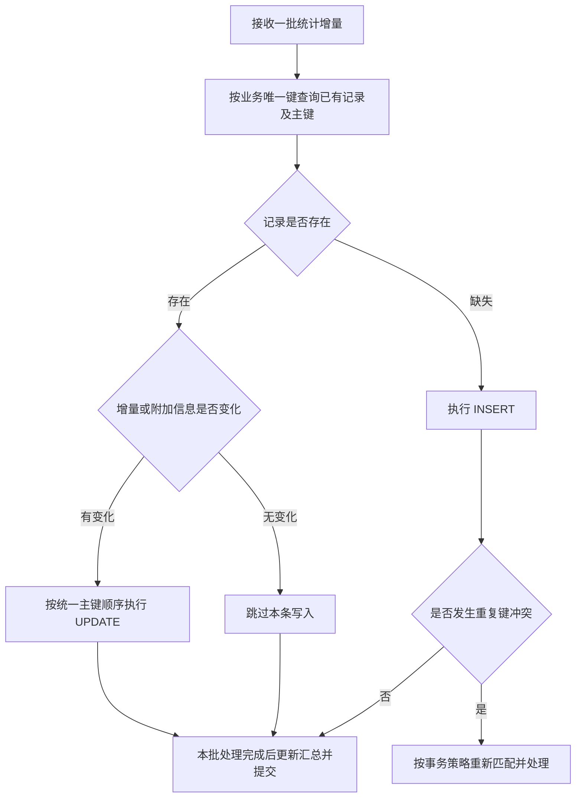

+++
title = "MySQL 批量 UPSERT 死锁的排查与修复"
description = "从一次高频统计写入故障出发，理解 InnoDB 索引锁、批量 UPSERT 和事务重试，建立从死锁取证到并发验证的排查方法。"
date = '2026-11-05T00:00:00+08:00'
draft = false
tags = ["MySQL", "InnoDB", "死锁", "事务", "并发"]
+++

一次高频统计写入故障中，应用不断收到 MySQL 死锁错误。补全更新条件、减少零增量写入并加入重试之后，大部分请求恢复了，少量请求仍会在重试耗尽后失败。

继续排查发现，失败集中在一条批量 `INSERT ... ON DUPLICATE KEY UPDATE` 上。更值得关注的是：在隔离测试中，即使各个并发任务处理的业务记录互不相同，原有写入路径仍能触发死锁。

这次排查最终落到了三个方面：**检查 SQL 实际访问的索引范围，为已有记录选择更直接的更新路径，在完整事务边界上处理重试。** 本文用通用计数场景解释这些做法，表名、字段和示例数据均已抽象化。

案例中的受控实验使用 MySQL 5.7.43。文中的表结构用于解释设计；实际死锁能否复现，还取决于完整索引、事务语句、隔离级别、数据分布和执行时序。

## 高频计数写入中的批量 UPSERT

假设一个服务接收采集端定期发送的指标增量，按日期保存明细，并同步累加汇总。日统计可以抽象成下面的表：

```sql
CREATE TABLE daily_counter (
    id          BIGINT UNSIGNED NOT NULL AUTO_INCREMENT,
    tenant_id   BIGINT UNSIGNED NOT NULL,
    client_id   BIGINT UNSIGNED NOT NULL,
    metric_id   BIGINT UNSIGNED NOT NULL,
    stat_date   DATE NOT NULL,
    total_count BIGINT NOT NULL DEFAULT 0,
    PRIMARY KEY (id),
    UNIQUE KEY uk_daily (
        tenant_id, client_id, metric_id, stat_date
    )
) ENGINE = InnoDB;
```

业务唯一键决定“同一个采集端的同一个指标，在同一天只有一条统计”。最直接的写法是批量 UPSERT：记录缺失时插入，记录已存在时累加。

```sql
INSERT INTO daily_counter
    (tenant_id, client_id, metric_id, stat_date, total_count)
VALUES
    (1, 101, 201, '2026-01-01', 3),
    (1, 101, 202, '2026-01-01', 0)
ON DUPLICATE KEY UPDATE
    total_count = total_count + VALUES(total_count);
```

这里沿用 MySQL 5.7 的 `VALUES(column)` 写法。MySQL 8.4 已将这种引用待插入值的方式标记为弃用，新代码应按目标版本使用行别名等语法；这项语法变化与本文讨论的锁竞争是两个问题。[UPSERT 语法说明](https://dev.mysql.com/doc/refman/8.4/en/insert-on-duplicate.html)

这类负载往往有两个特点：当天大部分记录已经存在；大量周期性请求的增量为零。于是，数据库反复执行插入尝试和唯一键冲突处理，最后只完成一次已有记录更新，甚至一次数值完全不变的更新。

UPSERT 简化了应用代码，但高频调用下仍需评估它实际走过的写入和加锁路径。

## 业务记录不同为何仍可能争用锁

InnoDB 的记录锁落在索引记录上。理解死锁时，需要同时观察主键、二级索引和索引间隙。

| 锁类型 | 保护的范围 | 与本案例相关的含义 |
| --- | --- | --- |
| 记录锁 Record Lock | 某条索引记录 | 更新记录时需要取得相应的排他锁 |
| 间隙锁 Gap Lock | 索引记录之间或边界上的间隙 | 可以阻止其他事务向该范围插入 |
| 临键锁 Next-Key Lock | 索引记录及其前面的间隙 | 范围扫描可能同时影响记录和相邻插入位置 |
| 插入意向锁 Insert Intention Lock | 待插入位置所在的间隙 | 插入过程可能等待其他事务持有的间隙锁 |

需要特别区分两件事：普通间隙锁之间可以共存；向同一间隙中不同位置插入的事务，也可以并行。**仅凭“落在同一个间隙”无法判定存在死锁，必须找到相互阻塞的锁请求。** [InnoDB 锁类型说明](https://docs.oracle.com/cd/E17952_01/mysql-5.7-en/innodb-locking.html)

UPSERT 同时涉及插入与冲突更新。MySQL 5.7 手册区分了重复主键和重复唯一键的加锁路径：前者涉及排他的索引记录锁，后者涉及排他的临键锁。具体现场仍需结合小版本、隔离级别和死锁日志分析。[不同 SQL 的加锁行为](https://docs.oracle.com/cd/E17952_01/mysql-5.7-en/innodb-locks-set.html)

因此，业务层的“各自处理不同的指标”只能说明业务唯一键不同，无法覆盖事务访问过的全部锁资源。一个批量语句处理多条记录，一个事务又可能操作多张表，这些路径交错后才形成实际的等待关系。

死锁的核心是循环等待。下面仅表示依赖关系，资源 A、B 可以是不同索引上的记录或相关间隙，不对应本案例的完整生产锁图：


## 从错误码追到实际等待的索引

### 先区分死锁和锁等待超时

应用日志里常见两类错误：

| 错误码 | 含义 | InnoDB 的回滚行为 |
| --- | --- | --- |
| `1213` | 检测到死锁 | 被选中的受害事务整体回滚 |
| `1205` | 锁等待超时 | 默认回滚当前语句；启用 `innodb_rollback_on_timeout` 时回滚整个事务 |

两者需要分别统计，事务框架也可能在数据库回滚之外进一步标记整个事务失败。处理前要确认实际事务状态，避免把所有锁异常都放进同一个重试分支。[InnoDB 错误处理说明](https://docs.oracle.com/cd/E17952_01/mysql-5.7-en/innodb-error-handling.html)

对 `1213`，至少关联请求标识、失败 SQL、事务中的语句顺序、重试次数和最终结果。一次请求可能产生多条重试日志，直接按错误日志行数统计，会放大受影响请求数。

### 尽早保存死锁现场

常用入口是：

```sql
SHOW ENGINE INNODB STATUS;
```

重点读取 `LATEST DETECTED DEADLOCK`，对照每个事务正在执行的语句、已经持有的锁、正在等待的锁，以及最终被回滚的事务。[InnoDB 监控输出说明](https://docs.oracle.com/cd/E17952_01/mysql-5.7-en/innodb-standard-monitor.html)

其中几个字段很有用：

| 日志信息 | 排查用途 |
| --- | --- |
| `index PRIMARY` 或某个二级索引名称 | 定位争用发生在哪个索引上 |
| `locks rec but not gap` | 识别仅针对索引记录的锁 |
| `locks gap before rec` | 识别记录前方的间隙锁 |
| `insert intention waiting` | 识别插入过程正在等待的锁请求 |
| `WAITING FOR THIS LOCK TO BE GRANTED` | 从等待方追到持有冲突锁的事务 |

`SHOW ENGINE INNODB STATUS` 只保留最近一次死锁。频繁发生时，可以由具备权限的维护人员在诊断窗口启用 `innodb_print_all_deadlocks`，将每次死锁写入错误日志，排查后恢复原设置。[死锁诊断建议](https://docs.oracle.com/cd/E17952_01/mysql-5.7-en/innodb-deadlocks-handling.html)

### 实时等待关系和历史死锁分别查看

在 MySQL 5.7 中，可以关联 `INNODB_LOCK_WAITS` 和 `INNODB_LOCKS`，查看当前谁在等待谁，以及等待涉及哪个索引：

```sql
SELECT
    w.requesting_trx_id AS waiting_trx,
    w.blocking_trx_id   AS blocking_trx,
    r.lock_table,
    r.lock_index,
    r.lock_type,
    r.lock_mode        AS requested_mode,
    b.lock_mode        AS blocking_mode
FROM information_schema.innodb_lock_waits AS w
JOIN information_schema.innodb_locks AS r
    ON r.lock_id = w.requested_lock_id
JOIN information_schema.innodb_locks AS b
    ON b.lock_id = w.blocking_lock_id;
```

这两张表展示实时等待及相关锁，查询需要相应权限。死锁被检测并解除后，等待关系可能已经消失，查询结果为空不能证明此前没有发生死锁。字段和权限见 [INNODB_LOCK_WAITS](https://docs.oracle.com/cd/E17952_01/mysql-5.7-en/information-schema-innodb-lock-waits-table.html) 与 [INNODB_LOCKS](https://docs.oracle.com/cd/E17952_01/mysql-5.7-en/information-schema-innodb-locks-table.html)。

MySQL 8.0 已移除上述两张表，对应排查应使用 Performance Schema 的 `data_locks` 和 `data_lock_waits`。不要直接把 5.7 的诊断 SQL 搬到新版本执行。[data_lock_waits 说明](https://dev.mysql.com/doc/refman/8.4/en/performance-schema-data-lock-waits-table.html)

## 第一轮调整先收窄写入范围

最初排查发现，汇总表有一个联合唯一索引：

```sql
UNIQUE KEY uk_tenant_metric (tenant_id, metric_id)
```

更新语句却只传入了后一个字段：

```sql
UPDATE total_counter
SET total_count = total_count + ?
WHERE metric_id = ?;
```

在 MySQL 5.7 中，仅按 `metric_id` 查找无法利用该索引的最左前缀进行定位。如果缺少其他合适索引，扫描范围可能扩大。这里还缺少租户边界，应补全为：

```sql
UPDATE total_counter
SET total_count = total_count + ?
WHERE tenant_id = ?
  AND metric_id = ?;
```

联合索引能否缩小访问范围，应结合 `EXPLAIN`、现有索引和真实数据分布确认。单看条件中出现了某个索引字段，无法判断执行计划是否合理。[联合索引说明](https://docs.oracle.com/cd/E17952_01/mysql-5.7-en/multiple-column-indexes.html)

另一项调整是跳过无意义的 `+0`。即使最终数值不变，一条 `UPDATE` 仍可能定位记录并申请锁。高频心跳下，这部分竞争值得先消除。

第一轮同时加入了事务和有限重试，后续观察到大多数失败尝试可以恢复。不过，继续按请求核对后发现：**剩余死锁发生时，汇总增量为空，最终失败的 SQL 集中在日统计表。**

这条证据缩小了下一轮排查范围。汇总表上的缺陷值得修复，日统计的批量写入路径还需要独立验证。

## 用对照实验验证批量写入路径

为了排除“只有同一采集端重复上报才会死锁”的假设，隔离测试使用合成数据，安排 4 个并发执行者，每个执行 12 轮，共 48 次事务尝试，每份数据包含 226 条统计记录。

原复盘记录了以下结果：

| 实验条件 | 成功事务 | 死锁失败 |
| --- | ---: | ---: |
| 已有记录继续走原批量 UPSERT | 24 | 24 |
| 各执行者的业务维度互不相同，仍走原批量 UPSERT | 24 | 24 |
| 已有记录改为按主键 UPDATE | 48 | 0 |
| 已有记录场景改用 READ COMMITTED | 48 | 0 |

这些数字描述特定环境下的事务尝试结果。它们不能直接换算成生产故障率，也不能说明任意批量 UPSERT 都会产生相同结果。

实验中还观察到了主键索引上的排他锁，以及 `insert intention waiting`。结合失败 SQL 和对照结果，可以判断原写入路径中的插入及冲突处理值得调整。**仅有这两个锁特征，还不足以重建完整的循环等待关系。**

生产环境当时未取得完整 InnoDB 锁图，因此结论保留在证据能够支持的范围：测试环境复现了问题，调整写入路径后该组实验未再出现死锁；每一次生产死锁是否具有相同锁链，仍需逐例取证。

复现时应保留完整 DDL、隔离级别、初始化数据、每个事务的语句顺序、并发同步方式和失败日志。只保留一条 UPSERT，往往会丢失触发死锁所需的前置条件。

## 将已有记录更新与缺失记录插入分开

第二轮改造让高频的已有记录写入直接进入更新路径：



### 已有记录使用数据库内的原子累加

取得主键后，已有记录可以执行：

```sql
UPDATE daily_counter
SET total_count = total_count + ?
WHERE id = ?
  AND tenant_id = ?;
```

这里直接在数据库中累加。若把查询到的旧值拿回应用，计算后再用 `SET total_count = 新值` 覆盖，并发写入就可能丢失增量。

当需要批量更新多个主键时，可以按主键升序逐条执行，或者评估带 `ORDER BY id` 的单表批量更新。MySQL 支持单表 `UPDATE` 指定更新顺序；`WHERE id IN (...)` 中参数的排列本身不构成顺序保证。[UPDATE 语法说明](https://docs.oracle.com/cd/E17952_01/mysql-5.7-en/update.html)

按主键命中已有记录，使访问路径更容易控制。二级索引变更、外键检查和其他写入路径仍会影响锁行为，因此还需要后续的事务与并发约束。

### 先查询再插入需要处理竞争窗口

一次普通查询得到“记录不存在”之后，另一个事务仍可能先插入相同业务键。因此，拆分写入路径时必须保留唯一约束，并明确重复键冲突的恢复方式。

一种容易验证的策略是：确认冲突来自预期的业务唯一键后，回滚本次事务，在有限次数内开启新事务，重新查询并计算写入集合。若选择在原事务内恢复，则要确认事务框架允许继续执行，并使用能够看到冲突记录的读取方式；在可重复读下，原有一致性快照可能继续看不到刚提交的记录。

批量插入还需确认失败语句的回滚范围。不能把“遇到重复键”直接当成“这批增量已经写入”，否则可能漏计。

如果真实业务键包含字符串，还应让应用匹配规则与数据库排序规则保持一致。大小写、重音或尾随空格的比较差异，都可能让应用判断为不同键，数据库却判定冲突。上面的整数示例省略了这类复杂度。

### 零增量按业务含义处理

跳过零增量写入需要区分几种情况：

| 记录状态 | 本次变化 | 处理方式 |
| --- | --- | --- |
| 当天记录缺失 | 增量为零 | 如果业务需要记录出现状态，仍然创建 |
| 记录已存在 | 增量为零，附加信息未变 | 跳过写入 |
| 记录已存在 | 增量为零，附加信息变化 | 更新必要字段 |
| 记录已存在 | 增量大于零 | 累加次数 |

这能减少大量周期性空更新，同时保留“当天出现过”和附加信息变化等业务语义。如果某个字段要求每次请求都刷新，就需要单独判断它是否适合与计数保存在同一条记录中。

## 隔离级别与加锁顺序需要配合调整

### READ COMMITTED 的收益与边界

在这个案例中，常规统计事务改为 `READ COMMITTED`。该级别下，普通搜索和索引扫描通常不再使用间隙锁；外键检查和重复键检查仍会使用相关锁。

同时，每次一致性读取都使用新的快照。依赖“事务内多次读取结果稳定”或防止范围内插入的逻辑，需要重新评估。切换时也应检查复制配置，MySQL 5.7 对该隔离级别要求使用行格式二进制日志；`MIXED` 模式会自动选择行格式。[隔离级别说明](https://docs.oracle.com/cd/E17952_01/mysql-5.7-en/innodb-transaction-isolation-levels.html)

因此，这项调整应限定在适合该语义的事务中。连接池环境优先通过事务管理器配置，并确认事务结束后连接状态正确恢复。

事务仍然需要保留。例如，日统计增加 5，汇总也应增加 5，这两个变化必须一起提交或一起回滚。删除事务会引入部分成功，掩盖掉的锁竞争可能转化成数据不一致。

### 所有写入入口遵守同一顺序

这个案例为每个采集端设置了串行化边界：统计事务先锁定对应的既有控制行，再处理日统计，最后处理汇总。不同采集端仍可并行。

当迁移或合并操作涉及多个采集端时，需要先按照统一顺序取得全部相关控制行的锁，再读写统计。控制行须存在，相关入口也须共同遵守协议；只改常规上报路径，无法约束后台迁移或补偿任务。

同样，同一张表内处理多条记录时，也应约定一致顺序。迁移完成后，按已成功合并的源记录主键删除，能够避免范围删除覆盖并发新增的记录。

事务内还应尽量减少网络调用、等待和无关计算，缩短持锁时间。统一顺序与短事务是降低冲突的通用手段，实际效果要结合所有写入入口验证。[死锁处理建议](https://docs.oracle.com/cd/E17952_01/mysql-5.7-en/innodb-deadlocks-handling.html)

## 死锁重试必须包住完整事务

对于 `1213`，InnoDB 已回滚受害事务，应用应重新执行整个事务中的相关操作。只重跑报错的最后一条 SQL，会遗漏此前已被回滚的修改。

下面的示例适用于当前调用拥有事务边界的情况，最多执行 3 次，包含首次尝试。`run_in_new_transaction` 代表负责开启、提交、回滚并清理事务状态的封装：

```text
for attempt in 1..3:
    try:
        run_in_new_transaction(isolation = READ_COMMITTED):
            acquire_control_row_locks_in_order()
            existing = query_existing_rows()
            plan = rebuild_write_plan(existing, original_deltas)
            apply_daily_changes(plan)
            apply_summary_changes(plan)
        return success
    catch error:
        # 到达这里时，本次事务已回滚并完成清理
        if mysql_error_code(error) != 1213 or attempt == 3:
            throw error
        sleep_with_bounded_random_backoff()
```

这个示例专门处理 `1213`。缺失记录插入时的重复键竞争，需要采用前面说明的独立策略，不能把全部数据库异常都视为死锁。

实现时尤其要注意三个边界：

- **每次尝试重新读取并构建写入计划。** 保留不可变的原始增量，避免复用已经失效的主键映射，或在内存中重复累计。
- **退避发生在事务结束之后。** 回滚清理完成后再做短暂随机等待，避免持锁休眠和多个请求同步重试。
- **由事务拥有者负责重试。** 如果当前方法加入了外层事务，应让外层整体回滚并重试；内层不能擅自开启并提交独立事务，破坏原有原子性。

事务重试与请求幂等还需要分别设计。如果数据库已经提交，随后响应丢失，采集端重新发送相同增量，就可能再次累加。这时需要稳定的请求标识，并让去重记录与统计更新原子提交。死锁重试只能恢复明确回滚的事务，无法解决提交结果不确定时的重复请求。

## 验证请求恢复也要验证最终计数

修复后的验证应覆盖数据库竞争和业务不变量。对计数服务，最基本的关系是：

```text
最终计数 = 初始计数 + 语义上应生效的增量之和
```

发生回滚的尝试不能额外贡献增量；一次请求经过多次事务尝试后成功，最终仍只应贡献一次。

本案例的定向并发测试覆盖了不同采集端混合发送零增量与正增量，以及正常写入与历史统计迁移交错执行。日统计的最终计数、迁移后的目标计数和源记录合并结果均符合预期。随后单节点的短期观察窗口内，也未再发现该上报路径的死锁或死锁重试日志。

这些结果支持本次调整有效，长期效果还需要在不同负载下持续观察。建立回归测试时，可以把以下场景纳入验证：

| 场景 | 重点检查 |
| --- | --- |
| 不同业务键并发写入 | 索引路径是否仍产生明显竞争 |
| 同一业务键并发累加 | 是否丢失或重复累计增量 |
| 首次创建时发生唯一键竞争 | 重试后是否恰好保留一条记录且计数正确 |
| 已有记录持续收到零增量 | 是否跳过无效更新并保留必要信息 |
| 日统计完成后，汇总写入失败 | 两部分是否一起回滚 |
| 统计写入与迁移并发 | 合并结果与源记录删除范围是否正确 |

线上指标则至少区分死锁次数、受影响请求数、重试恢复数、最终失败数和延迟分位数。错误报警下降只能说明通知减少；最终计数正确、写入次数减少和延迟改善，都需要各自的观测证据。

这次排查的关键，是从失败 SQL 出发，逐步把业务请求映射到事务、索引和锁资源，再用对照实验检验调整效果。对于以已有记录更新为主的高频计数场景，减少空写入、收窄索引访问范围、拆分更新与插入路径，通常比单纯增加重试次数更值得优先验证。
