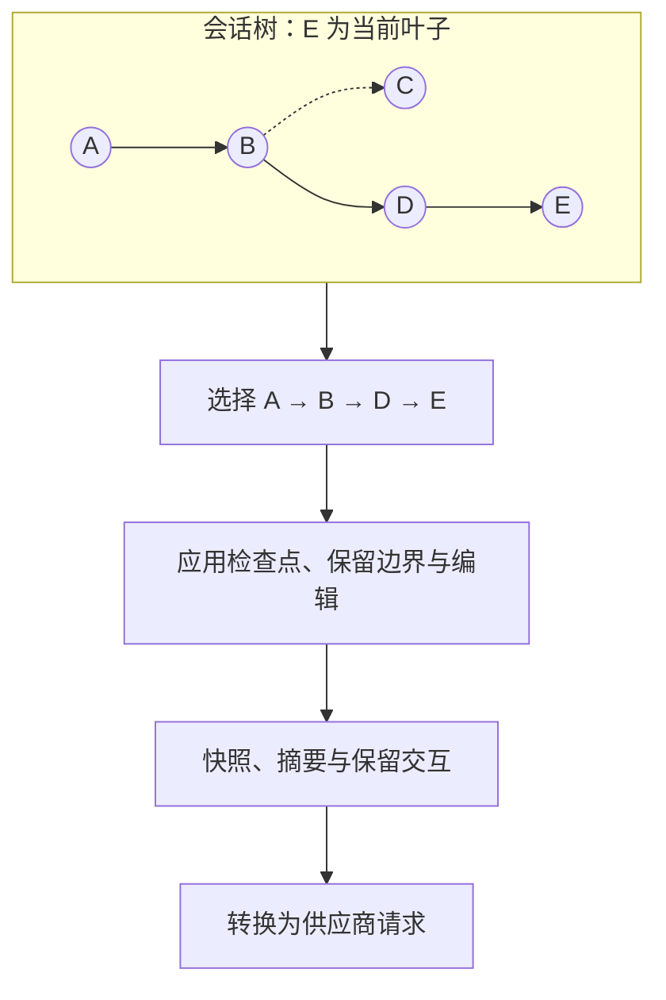
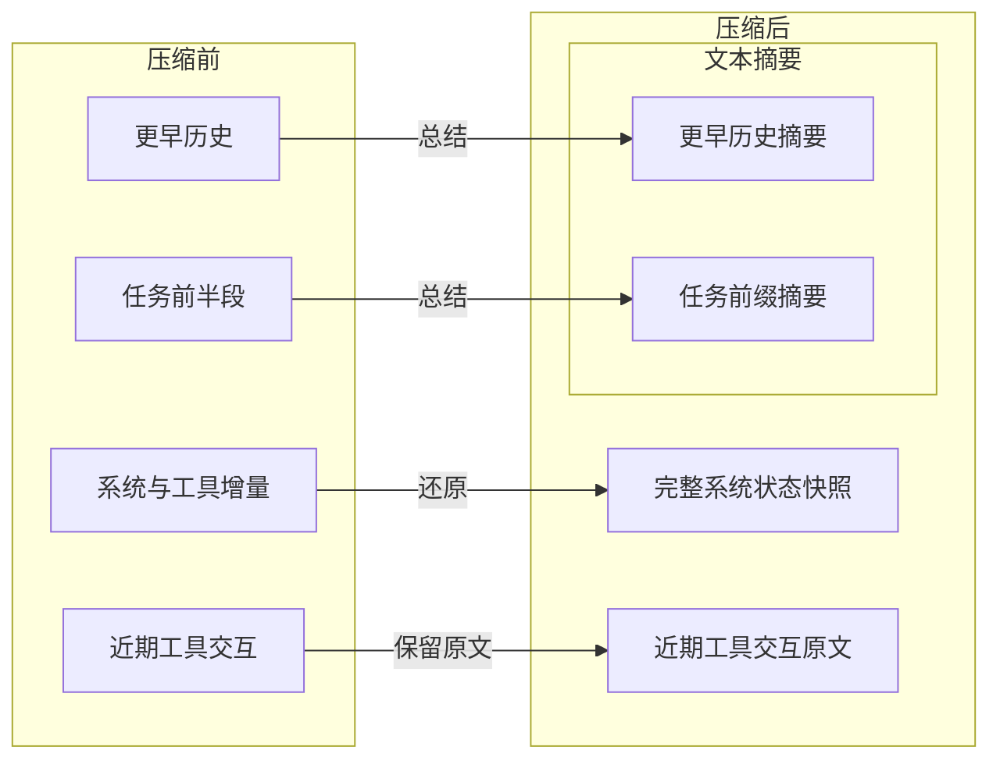

+++
title = "Pi 如何管理长任务的上下文"
description = "从会话投影、Token 估算到文本摘要与溢出恢复，理解 Pi 如何保留原始记录并组织长任务的模型输入。"
date = '2026-10-27T00:00:00+08:00'
draft = false
tags = ["LLM", "Agent", "Pi", "上下文管理", "上下文压缩"]
+++

编程 Agent 执行长任务时，会不断积累源码、命令输出、工具调用和用户补充要求。上下文接近容量上限后，生成一份摘要只是其中一步：程序还需要决定保留哪些原文、怎样承接工具调用，以及重启后如何恢复。

Pi 将这些问题组织在一条清晰的链路中：保存原始会话记录，沿当前分支生成模型可见的消息，结合 usage 和本地估算判断容量，再通过文本摘要、近期交互与系统状态快照构造后续输入。

这套设计的关键是**会话投影**。完整记录负责保存发生过的事情，投影负责表达当前这次推理需要看到什么。压缩、分支切换和失败恢复，都可以通过改变投影来影响下一次请求。

本文讨论 `earendil-works/pi` 中编程 Agent 的默认实现，源码链接固定到提交 `6c384aa30f619d7b28963f2bab24d8dacbe73cb6`，范围包括 `packages/coding-agent` 及其使用的 `packages/agent`、`packages/ai`。扩展可以改变默认策略，仓库内其他 harness 的行为需要单独分析。

## 从会话记录到模型请求

Pi 的上下文可以分成三个层次。

| 层次 | 主要内容 | 作用 |
| --- | --- | --- |
| 原始会话记录 | 消息、分支关系、压缩检查点、上下文编辑 | 保存历史，支持恢复和追踪 |
| 有效会话投影 | 当前分支经过压缩和编辑后的消息 | 表达下一次推理需要承接的内容 |
| 供应商请求 | 转换后的消息、系统提示和工具声明 | 满足具体模型接口的协议要求 |

主要处理过程可以表示为：

```text
会话条目
  → 沿当前叶子节点选择分支
  → 应用压缩检查点与上下文编辑
  → 检查预算，必要时等待摘要完成
  → 刷新系统提示和工具声明
  → 转换、标准化并适配模型协议
  → 发起请求
  → 将响应和工具结果追加到会话
```

磁盘中保存着一条记录，并不意味着下一次模型请求会包含它的全部内容。另一方面，中间消息列表也不等于最终请求体，模型协议适配和扩展仍可能调整输入。

这种分层让历史保留与窗口控制可以独立处理。为了缩短模型输入，无需同时删除用于复盘的原始材料。

## 会话投影如何选择有效历史

Pi 的会话条目带有 `id` 和 `parentId`。当前叶子节点决定正在使用哪条路线，沿父节点回溯，就能得到这一分支的顺序历史。

除了普通消息，会话还包含几类重要条目：

| 条目 | 保存的信息 |
| --- | --- |
| `compaction` | 摘要、近期保留边界、压缩前用量和系统状态快照 |
| `branch_summary` | 离开一条分支时需要带走的进展 |
| `context_edit` | 对某条记录在模型上下文中的替换或省略 |
| `custom_message` | 可进入模型上下文的扩展消息 |
| 自定义元数据 | 扩展自己的状态，可以不暴露给模型 |

`buildSessionProjection()` 先选择当前分支，再找到最新压缩检查点，按照 `firstKeptEntryId` 保留近期记录，并接上检查点之后的新内容。随后，它应用上下文编辑，生成消息列表，同时保留消息与原始条目的对应关系。具体实现见 [会话投影逻辑](https://github.com/earendil-works/pi/blob/6c384aa30f619d7b28963f2bab24d8dacbe73cb6/packages/coding-agent/src/core/session-manager.ts#L543)。

从原始会话树到模型可见消息，可以用下面的图理解：



*虚线表示其他分支，它仍保存在原始记录中。当前投影由最新摘要、系统状态快照、按边界保留的近期交互和检查点之后的新内容组成。*

旧检查点即使落在保留区间内，也不会继续贡献另一份生效摘要。这样，重复压缩可以更新当前状态，避免把多轮摘要层层叠加到模型输入中。

### 摘要怎样进入模型消息

调用模型前，消息还会经过 `transformContext`、`convertToLlm` 和 `normalizeContext` 等处理。

在默认转换中，压缩摘要和分支摘要会包装成带说明的 `user` 消息。普通系统状态仍通过自己的消息与协议适配表达。标记为 `excludeFromContext` 的 bash 执行记录则会被省略。相关规则见 [消息转换实现](https://github.com/earendil-works/pi/blob/6c384aa30f619d7b28963f2bab24d8dacbe73cb6/packages/coding-agent/src/core/messages.ts#L148)。

这个角色安排很重要：摘要承担历史交接职责，它不会在默认转换中被提升为新的 system 指令。

## 压缩还需要保存系统和工具状态

长任务中变化的内容还包括系统提示和工具声明。

Pi 可以通过 system 消息记录提示词分区的更新或删除，以及工具声明的增加和移除。后续回放这些变化，就能还原当前生效的状态。

例如，系统提示中的某个分区先设置了项目说明，后面又更新了它。模型下一次需要的是更新后的完整状态。`getCurrentSystemMessage()` 按分区标识合并这些变化，`getCurrentTools()` 则还原当前工具声明集合。源码见 [系统与工具状态回放](https://github.com/earendil-works/pi/blob/6c384aa30f619d7b28963f2bab24d8dacbe73cb6/packages/ai/src/utils/transcript.ts#L58)。

本地可执行工具与模型可见的工具声明也有不同职责。前者包含真正执行操作的实现，后者提供名称、说明和参数 schema。不同模型对对话中途变更工具的支持不同，最终编码需要由协议层处理。

### 增量状态需要一个完整快照

假设早期消息定义了一组工具，后面的消息只记录“移除某工具”。如果压缩直接丢掉早期定义，剩下的增量就无法独立还原完整状态。

Pi 在追加压缩检查点时，会先计算当前完整 system 状态，将它保存到 `systemMessage` 字段。重新投影时，压缩前保留区间内的旧 system 消息会被跳过，由检查点快照承接这部分状态。相关逻辑见 [appendCompaction](https://github.com/earendil-works/pi/blob/6c384aa30f619d7b28963f2bab24d8dacbe73cb6/packages/coding-agent/src/core/session-manager.ts#L1261)。

因此，一份可恢复的压缩检查点需要同时回答两类问题：任务已经做到哪里，以及当前系统提示和工具声明是什么。

## Token 预算如何跟随上下文变化

Pi 优先利用最近一次有效 assistant 响应中的 usage，再估算该响应之后新增的内容：

```text
当前上下文估计
= 最近有效响应对应的上下文用量
  + 后续消息的本地估计
```

例如，最近有效响应记录 60,000 tokens，之后工具结果和新消息又增加约 8,000 tokens，当前估计就是 68,000。此前已经计入 usage 的历史无需再次累加。

Pi 使用归一化后的 usage 字段，优先读取 `totalTokens`；缺少有效总数时，回退到输入、输出、缓存读取和缓存写入等分量。缓存命中的输入仍占上下文空间，费用上的优惠与窗口占用需要分别理解。

错误、取消和全零 usage 响应无法直接提供可靠的新锚点，程序会寻找此前的有效记录，或退回本地估算。源码见 [用量计算与估算](https://github.com/earendil-works/pi/blob/6c384aa30f619d7b28963f2bab24d8dacbe73cb6/packages/coding-agent/src/core/compaction/compaction.ts#L140)。

### 本地估算的精度边界

默认估算主要按内容字符量除以 4，再向上取整。这里使用的是 JavaScript 字符串 `.length` 等字符量计数，其语义与 UTF-8 字节数不同，也无法精确复现模型 tokenizer。

估算涉及文本、thinking、工具名称与参数、工具结果、系统提示和工具声明等内容。图片采用固定近似值，每张约折算为 1,200 tokens。不同语言、图片分辨率和模型编码方式都可能造成偏差。

这类方法的优势是计算成本低，适合做调度判断。把它视为所有输入类型的严格上界，会高估其可靠性。

### 压缩会让旧 usage 失效

假设历史原本占用 100,000 tokens。压缩后只保留摘要和近期内容，其中某条 assistant 消息仍携带压缩前的 usage。

继续使用这个旧数值，就可能让程序刚完成压缩，又判断上下文接近上限。

Pi 的 `estimateProjectedContextTokens()` 会追踪 usage 对应的原始条目，并检查它是否位于最近一次 `compaction` 或 `context_edit` 之后。只有测量结果仍适用于当前投影时，才继续使用这个锚点；否则重新估算投影，并将还原后的完整 system 状态计入一次。

这里体现了一个通用原则：**Token 数必须与它所测量的上下文版本关联。** 历史发生替换或省略后，旧测量值需要重新判断。

## 预留空间与近期保留量

参考版本的默认压缩配置如下：

| 配置 | 默认值 | 作用 |
| --- | ---: | --- |
| `enabled` | `true` | 开启自动压缩 |
| `reserveTokens` | 16,384 | 从上下文窗口中预留空间，用于计算触发阈值 |
| `keepRecentTokens` | 20,000 | 选择近期原文保留区间时的目标量 |

阈值判断为：

```text
contextTokens > contextWindow - reserveTokens
```

若窗口为 128,000 tokens，预留量为 16,384，触发阈值就是 111,616。这项判断使用严格大于，估计值恰好等于阈值时尚未满足条件。

`keepRecentTokens` 则影响历史切分。它与摘要生成量、新窗口总长度分别对应不同概念；消息边界、工具配对和摘要本身都会影响最终占用。

尤其需要注意，参考版本的摘要请求已经使用模型输出限制，并由请求层结合可用上下文调整。`reserveTokens` 在这里负责触发预算，不能直接当作摘要的最大输出量。

配置还支持按模型覆盖预留量与近期保留量。调整时需要结合模型窗口考虑，单纯把保留量设大，可能让压缩后仍缺少继续推理的空间。

## 压缩检查发生在执行循环内部

一次用户请求可以产生多次 assistant 响应与工具调用，工具输出可能在同一任务中快速填满窗口。

Pi 会在新运行准备阶段检查相关压缩条件，也会在工具完成、准备下一次 assistant 响应的 `prepareNextTurn` 阶段检查有效投影。一次底层运行结束后，还会根据最终响应处理阈值、溢出或可恢复截断。

新运行准备阶段的检查发生在新启动消息加入之前，因此它无法单独保证提前覆盖任意超大新输入的全部开销。

对于需要压缩的正常调用链，时序可以概括为：

```text
工具结果进入历史
  → 检查有效投影的预算
  → 等待压缩完成
  → 刷新上下文和系统状态
  → 开始下一次模型响应
```

默认路径会等待摘要完成后继续。这个等待边界让新上下文的生效时机比较明确；等待期间到达的用户引导消息，则需要继续遵守 Agent 循环的调度规则。

## 怎样切分历史并生成摘要

Pi 从最近内容向前累计估计量，参考 `keepRecentTokens` 找到保留边界，再将切点调整到合法位置。

工具调用关系会约束切分方式。例如：

```text
assistant：调用 read 读取文件
toolResult：返回文件内容
```

如果只保留第二条，模型就会看到缺少调用来源的工具结果。Pi 不允许将普通切点直接放在 `toolResult` 上，也不会把 system 消息当作普通候选切点。合法边界优先于精确凑齐某个 Token 数量。

### 一个用户任务也可以被分段总结

当单个用户任务执行了很多轮工具调用，完整保留这一任务可能无法释放足够空间。切点落在任务中间时，Pi 可以组合三部分内容：



*图示为切点落在单个任务内部的 split turn 场景。箭头对应内容的处理方式，系统状态快照独立于对话摘要保存。*

这个机制通常称为 split turn。原始目标和前面的决策通过任务前缀摘要传递，近期工具结果仍能保留原文。

摘要生成会按需要顺序处理更早历史和当前任务前缀。如果更早历史为空，可以沿用已有摘要，因此一次压缩所需的模型调用次数也会随材料结构变化。

### 默认摘要是独立的模型调用

本地程序负责准备材料、发起请求和安装结果，文本摘要由模型生成。

待总结的消息会先序列化为带角色和内容的文本，放入摘要请求。已有摘要也会作为材料参与更新。默认结构围绕目标、约束、进展、关键决定、下一步和必要上下文组织内容。

摘要请求不暴露主任务的业务工具集合，返回结果如果包含工具调用，会被判为摘要失败。普通情况下使用当前选择的模型；虚拟模型配置则可能通过路由解析到实际模型。相关过程见 [摘要生成实现](https://github.com/earendil-works/pi/blob/6c384aa30f619d7b28963f2bab24d8dacbe73cb6/packages/coding-agent/src/core/compaction/compaction.ts#L696)。

重复压缩时，旧摘要与这次需要压缩的历史一起参与更新，其中可以包括上轮保留下来、如今已经变旧的交互。总结范围因此可能跨过上一个压缩检查点。

## 检查点如何生效和恢复

一次成功压缩的主要步骤是：

```text
准备材料与切点
  → 运行压缩前扩展钩子
  → 生成摘要或采用扩展结果
  → 检查取消状态
  → 追加 compaction 检查点
  → 重建有效投影
```

检查点除了 `summary`，还包含近期保留边界 `firstKeptEntryId`、压缩前用量 `tokensBefore`、系统状态 `systemMessage`，以及摘要调用用量、来源和附加信息等字段。默认附加信息会记录文件读取与修改情况。

这里有两种容易混淆的用量：压缩前业务上下文的大小，以及生成摘要这个请求本身的消耗。后者需要进入资源统计，但不能直接拿来代表压缩后的业务上下文大小。

持久化开启时，Pi 将条目写入 JSONL。压缩通过追加检查点表达新的边界，原始对话继续留在会话记录中。重启后沿当前分支重放检查点和编辑记录，即可恢复有效投影。

### 结构检查与摘要质量分别验证

默认生成器会识别错误、输出长度截断和不应出现的工具调用，外层也会检查取消状态。这些检查可以拒绝部分无效响应，摘要是否遗漏重要语义仍需通过任务表现判断。

参考实现会计算压缩后的估计量用于反馈，但没有将“压缩后必须更小”作为默认提交检查点的硬性条件。一次成功摘要也无法保证新窗口一定低于模型限制。

追加检查点同样需要考虑持久化失败。内存更新与文件写入的顺序，决定了程序能否在错误后恢复一致状态；仅凭追加式记录，无法推导出完整的事务保证。

## 溢出恢复为何需要上下文编辑

正常阈值压缩是在为后续推理腾空间。上下文溢出后的恢复，还需要处理已经产生的失败尝试。

| 情形 | 主要处理 |
| --- | --- |
| 正常回答后超过阈值 | 压缩历史，为后续请求准备空间 |
| 回答成功但用量触及溢出判断 | 保留成功回答，压缩后不重复回答 |
| 明确的上下文溢出错误 | 整理失败尝试，允许一次压缩后重试 |
| 符合恢复条件的提前长度截断 | 尝试一次压缩恢复，避免无限循环 |
| 用户取消 | 尊重取消状态，避免将其当作普通溢出重跑 |

提前长度截断的恢复判断会比较实际输出量与原本期望的输出限制。这个条件表示可以尝试恢复，无法据此认定每个 `length` 结束都是上下文溢出。

进入恢复路径时，Pi 会先为选定的失败 assistant 消息及相关工具结果追加 `context_edit`，将 `replacement` 设为 `null`。投影据此省略这些内容，原始记录仍可用于追踪。

整个顺序是：

```text
追加失败尝试的省略编辑
  → 尝试压缩
  → 成功后追加检查点
  → 在允许恢复时继续执行
```

这带来一个重要边界：如果后续压缩失败或被取消，前面已经追加的省略编辑仍然存在。没有新压缩检查点，并不代表有效上下文完全保持原样。

一次恢复链中，已经执行过压缩重试后再次失败，会报告恢复失败。相关分类、编辑顺序和防重复判断见 [自动压缩恢复逻辑](https://github.com/earendil-works/pi/blob/6c384aa30f619d7b28963f2bab24d8dacbe73cb6/packages/coding-agent/src/core/agent-session.ts#L3011)。

## 分支摘要与扩展如何参与

分支摘要解决的是切换探索路线时的信息传递问题。

例如，在分支 A 尝试一种修复方案失败后，回到较早节点开始分支 B。分支摘要可以把“方案 A 做过什么、为什么没有奏效”带入新路线，减少重复探索。

`/tree` 导航提供相关摘要选项，是否生成摘要取决于操作选择。它与控制当前窗口大小的 compaction 共享部分摘要能力，各自保留的边界和目的仍有区别。

Pi 也允许扩展参与压缩。`session_before_compact` 可以读取准备结果、取消操作或返回自定义摘要结果；请求前的上下文变换还可能继续调整实际消息。分析安装了扩展的会话时，需要将这些变换纳入考虑。

手动 `/compact [instructions]` 可以增加摘要关注点。手动入口会先中止当前运行，再进入压缩；自动压缩则从执行循环的调度位置进入。两者共享默认摘要能力，恢复与重试含义由各自入口决定。

## 与 Codex 的实现放在一起看

结合上一篇 [Codex 如何管理长任务的上下文](/posts/codex-context-management/)，可以看到两种实现对相同问题的不同处理方式。

| 维度 | 本文的 Pi 默认实现 | 前文讨论的 Codex 实现 |
| --- | --- | --- |
| 有效上下文 | 沿会话分支生成投影，应用检查点与编辑 | 维护有效历史，压缩后重建并替换 |
| 压缩结果 | 可读文本摘要、近期原文、系统状态快照 | 按模式选择文本摘要、服务端压缩条目或新窗口流程 |
| 用量判断 | 有效 usage 加尾部估算，投影变化会使旧锚点失效 | 结合 usage、增量估计、统计范围和窗口上限 |
| 生效时机 | 在调度边界等待摘要完成后继续 | 部分路径支持后台候选，并在安装前检查兼容性 |
| 持久化 | JSONL 条目、分支关系和压缩检查点 | rollout 记录、替代历史与恢复元数据 |

这些差异对应两篇文章各自的固定版本和配置范围。对自建 Agent 更有价值的共同点，是记录、模型视图、预算与恢复机制之间清楚的职责划分。

最小实现可以先保存原始事件，再用独立函数构造模型输入；为 usage 标记来源，在历史变化后判断它是否失效；按完整交互边界选择保留内容；将摘要准备、生成、检查和提交分成可观察的步骤。

压缩后的效果最终要通过任务继续执行来验证：用户约束是否仍被遵守，已经完成的工作是否被准确承接，失败路线是否被重复尝试，剩余事项是否继续推进。窗口节省了多少空间，与任务保留了多少有效状态，值得一起衡量。
